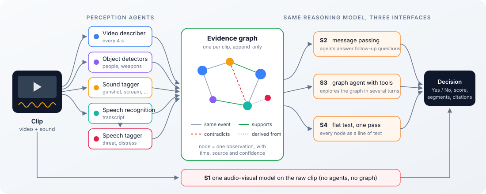
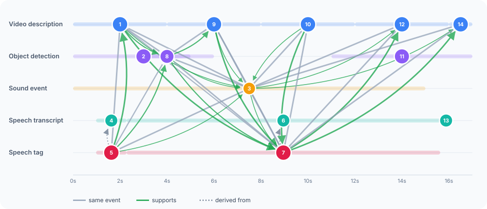

# What Helps Language-Model Agents Review Violent Video?

[](https://amine0110.github.io/evidence-graph-agents/)
[](https://huggingface.co/datasets/amine0110/xd-violence-review)
[](LICENSE)


Code for *What Helps Language-Model Agents Review Violent Video? A Controlled
Comparison with a Human Evidence Reference* (Mokhtari, Mancas, Vandenbulcke,
University of Mons). **Project page:** <https://amine0110.github.io/evidence-graph-agents/>

<p align="center">
  
</p>

Perception agents (video description, object detection, sound tagging, speech
recognition and speech tagging) write what they observe into an evidence graph,
one per clip. Four systems then decide whether a clip needs a security
operator's attention: a single audio-visual model on the raw clip (S1), the
agents exchanging messages (S2), a reasoning agent exploring the graph with
tools (S3), and the same observations as flat text in one pass (S4).

The human reference used in the paper (decisions, incident segments and the
evidence modality used, by two annotators) is on Hugging Face, with access on
request: <https://huggingface.co/datasets/amine0110/xd-violence-review>. No
video is included anywhere; the XD-Violence videos must be obtained from the
official XD-Violence page.

## Layout

| Path | Content |
| --- | --- |
| `src/evgraph/` | evidence graph schema and append-only store |
| `experiments/c3_agents/` | perception agents, edge builder, the four systems, evaluation (see its README) |
| `experiments/c3_agents/frozen/` | evaluation set hash, development set, final scores, cost per clip, graph statistics |
| `experiments/c1_relation/`, `experiments/c2_reasoning/` | placeholders for later work |
| `tests/` | unit tests |
| `docs/` | project page (GitHub Pages) and the script that builds its data from `frozen/` |

## Evidence graph

- **Node** = one observation, never a world entity: `id`, `modality` (text,
  image, video, audio_event, speech), `kind`, `content`, `t_obs` (time span
  observed), `t_rec` (when recorded), `source` (producer, version, input,
  offset), `confidence`, optional ground-truth `label`.
- **Edge** = typed relation: `same_event` (symmetric, graded), `supports`,
  `contradicts` (directed, graded), `precedes`, `derived_from` (directed, no
  score). Every edge has a producer and a confidence.
- **Veracity** = a belief value for a node at a time. Beliefs are appended,
  never overwritten; the newest counts.
- Storage: one JSONL file per agent and clip, one record per line.

<p align="center">
  
  <br><em>The evidence graph of the worked example in the paper, on a timeline. Explore it interactively on the <a href="https://amine0110.github.io/evidence-graph-agents/#graph">project page</a>.</em>
</p>

```python
from evgraph import EvidenceGraph, EdgeType

g = EvidenceGraph("graph.jsonl")
past = g.neighbours(node_id, types=[EdgeType.CONTRADICTS], recorded_before=t)
```

## Reproducing the paper

GPU steps were run on a SLURM cluster (job scripts in
`experiments/c3_agents/slurm/`); graph building and evaluation run on any
machine. `experiments/c3_agents/README.md` lists the steps in order. All LLM
inference uses greedy decoding; every results file records the model and
prompt version.

```bash
pip install -e ".[test]"
pytest
```

## Project page

`docs/` is served by GitHub Pages. Its numbers are read from `experiments/c3_agents/frozen/`; after a change there, rebuild the data files and figures with

```bash
python docs/build_site_data.py --graphs path/to/XD-Violence/graphs
```

and preview locally with `python -m http.server --directory docs`.

## Citation

```bibtex
@misc{mokhtari2026violentvideo,
  title  = {What Helps Language-Model Agents Review Violent Video?
            A Controlled Comparison with a Human Evidence Reference},
  author = {Mokhtari, Mohammed El Amine and Mancas, Matei and Vandenbulcke, Virginie},
  year   = {2026},
  note   = {Preprint, University of Mons}
}
```

## Licence

Code under the MIT licence (`LICENSE`). The human annotations on Hugging Face are under CC BY-NC 4.0.
